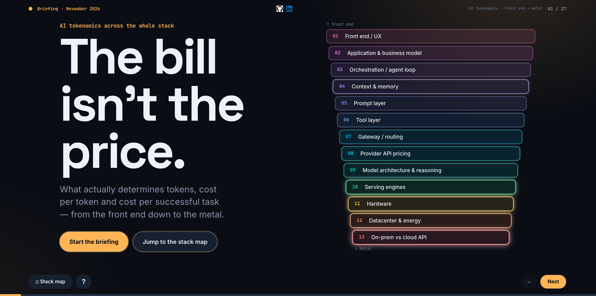

# AI Tokenomics Across the Whole Stack - 13 Layers

**An interactive briefing on what really drives the cost of running AI — from the front end down to the metal.**

`13-layers-of-ai-tokenomics
` is a single, self-contained web page that presents the briefing *“AI Tokenomics Across the Whole Stack”* as an interactive slide deck. It explains why the cost of an AI task is driven far more by **token volume** and **GPU utilisation** than by vendor list prices, and it walks through every layer of the stack where tokens and cost are created.

> Volume and utilisation move cost 5–100×. List prices move it 2–5×.
> Count tokens. Divide by success. Then negotiate price.

## What the page provides

- **27 slides** in a dark design with one colour per stack layer:
  - Cover, thesis and TL;DR.
  - The core equation: cost per successful task.
  - Key findings and an interactive stack map that acts as the navigation hub.
  - One slide for each of the 13 layers: front end, application, agents, context, prompt, tools, gateway, provider pricing, model architecture and reasoning, serving engines, hardware, datacenter and energy, and on-prem vs API.
  - Cross-cutting risks, an observability dashboard, a layer-by-layer summary table, recommendations, caveats and sources.
- **Two interactive explorers:**
  - **Reasoning effort** (medium vs max): tokens, cost per task and benchmark score.
  - **GPU utilisation** (near idle, enterprise or saturated load): cost per million tokens on identical H100s.
- **Deep-dive pop-ups** for the evidence behind key claims: equation terms, media token costs, success-rate maths, provider quality, caching comparisons and on-prem data points.
- **Toggles and tabs**, for example Tool Search on/off and the three Layer 9 tabs (9A, 9B, 9C).
- **Hover descriptions** on every interactive element, plus plain-language definitions for about 60 technical terms such as KV cache, MoE, PUE and prefix caching.
- **“About this slide”** panel (the **?** button) describing each slide and how to use it.
- **Responsive layout** for desktop, tablet and phone, keyboard support, and reduced-motion support.

## Usage

**View it.** Open `tokenomics.html` in any modern browser. There is no build step, no server and no installation.

**Host it.** The file is static, so any static host works. To use GitHub Pages:
1. Rename the file to `index.html`, or link to `tokenomics.html` directly.
2. Enable Pages in the repository settings.

**Navigate:**

| Action | Mouse / touch | Keyboard |
|---|---|---|
| Next / previous slide | **Next** / **←** buttons, or swipe | `→` / `←`, `Space`, `PageDown` / `PageUp` |
| First / last slide | **↺ Start over** | `Home` / `End` |
| Stack map (overview) | **◫ Stack map** | `M` |
| About this slide | **?** | `I` |
| Close a pop-up | ✕ or click outside | `Esc` |

**Deep links.** Every slide has its own address, so you can share a specific slide:
`tokenomics.html#equation`, `#stack-map`, `#layer-1` … `#layer-13`, `#effort-explorer`, `#utilisation-explorer`, `#observability`, `#summary`, `#recommendations`.

**Dependencies.** None besides Google Fonts (Space Grotesk, Inter, JetBrains Mono). The page falls back to system fonts when offline.

## About the data

Model names, prices and benchmark figures reflect provider documentation and public benchmarks as of **October–November 2026**. Several figures are vendor-reported best cases, and self-hosting break-even estimates in the literature disagree by more than 10×. See the *Caveats & sources* slide, and verify current figures before using them for budgeting.

## Reuse and license

You are free to use, copy, modify, share and build on this page, including commercially, under the **[MIT License](LICENSE)**.

The only condition is attribution: **keep the copyright notice with the author’s name** in all copies or substantial portions. When you present or publish an adapted version, please credit:

> Based on *“AI Tokenomics Across the Whole Stack”* by **Gerd Pruessmann** — https://github.com/2digitsleft

**Trademarks.** The LinkedIn and GitHub logos used for the profile links are trademarks of their respective owners. They are not covered by the MIT License. Replace or remove them if you reuse the page for your own profiles.

## Author

**Gerd Pruessmann**
- GitHub: [@2digitsleft](https://github.com/2digitsleft)
- LinkedIn: [pruessmann](https://www.linkedin.com/in/pruessmann/)
